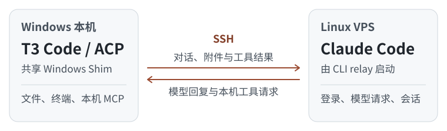

<p align="center">
  
</p>
<h1 align="center">T3 Claude VPS</h1>
<p align="center"><strong>Claude 账号留在 VPS，代码在你的 Windows 电脑上改。</strong></p>
<p align="center">
  <a href="https://github.com/Barometer-2002/t3-claude-vps/tags"></a>
  <a href="https://github.com/Barometer-2002/t3-claude-vps/actions/workflows/checks.yml"></a>
  <a href="https://github.com/Barometer-2002/t3-claude-vps/blob/main/LICENSE"></a>
  <a href="https://github.com/Barometer-2002/t3-claude-vps/stargazers"></a>
  <a href="https://github.com/Barometer-2002/t3-claude-vps/forks"></a>
</p>
<p align="center">
  <a href="#快速开始"><strong>快速开始</strong></a> ·
  <a href="#工作原理">工作原理</a> ·
  <a href="#acp-v1-接入">ACP v1 接入</a> ·
  <a href="#文档">文档</a> ·
  <a href="https://github.com/Barometer-2002/t3-claude-vps/blob/main/CHANGELOG.md">更新记录</a>
</p>

---

## 这个项目解决什么问题

你担心 Claude 账号风控，想让 Claude Code **一直从同一台 VPS 登录、走固定 IP 发请求**。但你日常写代码的仓库、编译器、测试环境全在 Windows 上。直接在 VPS 干活，就得把仓库搬过去、在服务器上装一整套开发环境。

**T3 Claude VPS 把两部分接起来。** 账号和模型请求走 VPS，读文件、改代码、跑测试在 Windows 上完成。在 T3 Code 里打开本地项目并选择 **Claude VPS** 即可使用。Windows 切换网络后，只要能重新连上同一台 VPS，后续模型请求仍由该 VPS 发出。

## 工作原理

<p align="center">
  
</p>

一轮任务的流程：

1. **你发消息** → Windows Shim 经 SSH 把消息送到 VPS 上已登录的 Claude Code → Claude Code 向模型服务发请求。
2. **Claude 要用工具**（读文件、跑命令、搜索代码）→ VPS relay 把工具请求送回 Windows → 在你电脑上的项目目录里执行 → 结果再送回 VPS → Claude 继续工作。
3. **你看到结果** → 模型回复流回客户端，T3 Code 里还能看到 Read、Edit、Bash 等工具卡片。

账号环境在 VPS，项目目录在 Windows。对话内容、附件和工具结果会经过 VPS 并可能进入模型请求。详见 [架构与数据流](docs/ARCHITECTURE.md) 和 [安全说明](SECURITY.md)。

## 两种使用方式

| 入口 | 说明 |
| --- | --- |
| **T3 Code** | 安装后多出一个独立的 **Claude VPS** Provider，和已有的 Claude Provider 并存。直接在 T3 里选它就能用。 |
| **ACP v1** | 在支持自定义 ACP v1 stdio Agent 的客户端中配置 `claude-vps-acp.exe`。可以单独安装，也可以和 T3 共用桥接。详见 [ACP v1 接入](#acp-v1-接入)。 |

## 快速开始

**前提**：VPS 上已安装并登录 Claude Code，Windows 能用公钥 SSH 免密连上这台机器。两端完整的依赖清单和首次配置见 [安装指南](docs/SETUP.md)。

在源码根目录打开 PowerShell 7，把 `my-linux-host` 换成你的 SSH 别名：

```powershell
# 1. 生成配置
python .\installer\configure.py --ssh-host my-linux-host --t3-only

# 2. 部署并注册 T3 Provider
pwsh -NoProfile -File .\install.ps1 -T3Only

# 3. 检查状态
node .\t3-native\manage-native.mjs status
```

打开 T3 Code，选择一个 Windows 项目，新建 **Claude VPS** 会话。让 Claude 读一份你知道存在的本机文件，确认返回的是项目里的内容。

## ACP v1 接入

ACP（Agent Client Protocol）让其他客户端也能用这套桥接。包装器复用锁定版本的 `claude-agent-acp`，通过共享 Shim 启动远端 Claude Code。你在自己选的客户端里对话，Claude Code 仍用 VPS 上的登录状态，文件和命令仍在 Windows 执行。

```powershell
# 仅安装 ACP
python .\installer\configure.py --ssh-host my-linux-host --t3-only
pwsh -NoProfile -File .\install.ps1 -AcpOnly

# 同时安装 T3 和 ACP
pwsh -NoProfile -File .\install.ps1 -T3Only -WithAcp
```

在客户端的自定义 ACP Agent 里填入 `%USERPROFILE%\.claude-vps\acp\claude-vps-acp.exe` 的绝对路径，选择 stdio 连接。支持新建会话、多轮交互，以及用原会话 ID 和原工作目录跨重启续接。会话列表、历史回放和分支暂未开放。详见 [ACP v1 指南](docs/ACP.md)。

## 日常管理

| 操作 | 命令 |
| --- | --- |
| 查看状态 | `node .\t3-native\manage-native.mjs status` |
| 更新安装 | `pwsh -NoProfile -File .\install.ps1 -T3Only` |
| 卸载 T3 接入 | `pwsh -NoProfile -File .\uninstall.ps1` |

更新前先结束正在运行的任务。卸载后仍保留 `claude-home` 和共享桥接。远端诊断、事务恢复和自定义路径见 [运维与排障](docs/OPERATIONS.md)。

## 文档

**使用**：[T3 Code 使用指南](docs/T3CODE.md) · [ACP v1 指南](docs/ACP.md) · [附件指南](docs/ATTACHMENTS.md) · [常见问题](docs/FAQ.md)

**部署**：[安装指南](docs/SETUP.md) · [配置参考](docs/CONFIGURATION.md) · [兼容说明](docs/COMPATIBILITY.md) · [运维与排障](docs/OPERATIONS.md)

**开发**：[架构与数据流](docs/ARCHITECTURE.md) · [扩展工具](docs/EXTENDING.md) · [Fork 说明](docs/FORK_CHANGES.md) · [贡献指南](CONTRIBUTING.md)

---

本项目 fork 自 [claude-vps-bridge](https://github.com/vv-get-ti/claude-vps-bridge)，采用 [LGPL-3.0-only](LICENSE)。[版本标签](https://github.com/Barometer-2002/t3-claude-vps/tags) · [构建状态](https://github.com/Barometer-2002/t3-claude-vps/actions/workflows/checks.yml) · [LINUX DO](https://linux.do/)
