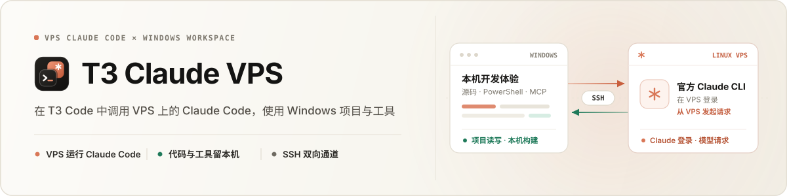

<p align="center">
  <picture>
    <source media="(prefers-color-scheme: dark)" srcset="docs/assets/banner-dark.svg">
    <source media="(prefers-color-scheme: light)" srcset="docs/assets/banner.svg">
    
  </picture>
</p>

<p align="center">
  
  <a href="https://github.com/vv-get-ti/claude-vps-bridge"></a>
  
  <a href="LICENSE"></a>
</p>

<p align="center">
  <a href="#这个项目做什么">做什么</a> &nbsp;·&nbsp;
  <a href="#与上游的区别">与上游的区别</a> &nbsp;·&nbsp;
  <a href="#快速开始">快速开始</a> &nbsp;·&nbsp;
  <a href="#工作原理">工作原理</a> &nbsp;·&nbsp;
  <a href="docs/T3CODE.md">T3 Code 指南</a> &nbsp;·&nbsp;
  <a href="docs/FAQ.md">常见问题</a>
</p>

> [!NOTE]
> **本项目 fork 自 [`vv-get-ti/claude-vps-bridge`](https://github.com/vv-get-ti/claude-vps-bridge)**，基线为上游 `0.14.1`（`0acd8a0`）。
> 上游是 CodexHost 桌面端插件。本 fork 把同一套桥接接入 [T3 Code](https://github.com/pingdotgg/t3code)，可以不装 CodexHost 单独使用，同时保留上游的 CodexHost 插件。
> 许可证沿用 LGPL-3.0-only。改了什么、没改什么，见 [Fork 说明](docs/FORK_CHANGES.md)。

## 这个项目做什么

**在 Windows 本地开发环境中运行 Linux VPS 上的官方 Claude Code：源码、编译器、终端、GPU、浏览器和本地 MCP 留在 Windows，模型会话与登录态隔离在 VPS；对外提供 T3 Code 原生接入与标准 ACP 协议包装（并保留上游 CodexHost 插件）。**

- **VPS 端**运行官方 `claude` CLI。登录状态、原生会话记录和模型请求都在 VPS 上（独立模式不再需要 VPS 端 `npm` 或 `@codexhost/cli`）。
- **Windows 端**保留项目目录和开发环境。文件读写、搜索、PowerShell、构建、测试和本地 MCP 工具都在本机执行。
- **中立 Shim 与接入层**：共享中立 Shim（`%USERPROFILE%\.claude-vps\shim\claude-vps-shim.exe`）经由单条 SSH 连接与 VPS 上的 `claude-stream-relay.mjs` 交互；上层提供 **T3 Code 原生注册**（`t3-native/`）与基于官方 `@agentclientprotocol/claude-agent-acp` 的 **标准 ACP 协议包装**（`acp/`）。

在 T3 Code 里，它会注册为一个单独的 Provider 实例，名为 **`Claude VPS`**。选中它后，用法和 T3 自带的 Claude 一样：权限审批、额度显示、自动标题、`--resume` / fork 会话都可以用。它不改默认的 `claudeAgent` 实例，不碰本机 `~/.claude`，也不改 T3 Code 的程序文件。

### 适合的情况

- Claude Code 的登录或网络环境放在 VPS 上，但代码、GPU、编译器和浏览器都在自己的 Windows 电脑上。
- 不想把项目同步到 VPS，也不想在 VPS 上重新搭一套构建环境。
- 主力客户端用 T3 Code，或者 T3 Code 和 CodexHost 都在用。

### 不适合的情况

- 本机可以直接使用 Claude Code：直接用 T3 Code 自带的 Claude 即可，不需要这个桥接。
- 要求项目内容完全不离开 Windows：Claude 读取的文件内容、命令输出和 MCP 返回值会传到 VPS，也可能进入模型请求（见[数据边界](#工作原理)）。
- 只用 CodexHost：可以直接用[上游项目](https://github.com/vv-get-ti/claude-vps-bridge)，也可以用本 fork 的 CodexHost 模式，两者行为一致。

---

## 与上游的区别

| | 上游 `claude-vps-bridge` | 本 fork `t3-claude-vps` |
|---|---|---|
| 宿主 | CodexHost 0.20.0+ | **T3 Code 原生接入**、**标准 ACP 协议包装**，也可与 CodexHost 共存或只装 CodexHost |
| 是否必须安装 CodexHost | 是 | 否（`--t3-only` / `--standalone`，独立模式跳过 VPS `@codexhost/cli` 与 `npm`） |
| 接入层 | 无 | 中立 `shim/` 内核 + `t3-native/` 原生注册 + `acp/` 标准 ACP 薄包装（复用锁版本官方 `@agentclientprotocol/claude-agent-acp`） |
| MCP | 本机 Playwright、VPS 端 Tavily | 另外由 Windows 端代理 T3 内置 MCP 和本机配置的 HTTP / Stdio MCP，并在本机做权限检查 |
| 读图预览 | — | 远端 `.bridge-media` 路径映射回 Windows 原始路径，T3 读图卡片正常显示 |
| T3 中调用本机 Skills / Commands | — | 发送 `/skill`、`$skill`、`/command` 时由 Shim 展开 Windows 本机 `.claude/{skills,commands}` |
| 核心桥接（协议 3、工作区运行时、事务部署） | — | **沿用上游**，仅做向后兼容的加固 |
| 插件 ID、配置文件名、远端目录 | `claude-vps` / `bridge-config.local.json` / `~/.codexhost/windows-bridge` | **不变**，可以直接从上游迁移 |

完整的文件变更清单见 [docs/FORK_CHANGES.md](docs/FORK_CHANGES.md)。

---

## 快速开始

### 1. 准备环境

- **Windows**：Node.js 24+、PowerShell 7、OpenSSH 客户端、Python 3.11+、npm、ripgrep（`rg`）、系统自带的 .NET Framework 4（`csc.exe`）。本机**不需要**安装或登录 Claude Code。
- **Linux x64 VPS**：Python 3、Bash、Node.js 24（仅 CodexHost 共存模式额外需要 `npm`），已安装并登录官方 [Claude Code](https://code.claude.com/docs/en/setup)。Windows 上要配好连到这台 VPS 的免密 SSH 别名（见[安装指南](docs/SETUP.md)）。

### 2. 安装（独立模式，不需要 CodexHost）

在仓库根目录打开 **PowerShell 7**：

```powershell
# 生成配置（把 my-linux-host 换成你的 SSH 别名；--standalone 与 --t3-only 等价）
python .\installer\configure.py --ssh-host my-linux-host --t3-only

# 方式 A：部署桥接 + 中立 Shim + T3 Code 原生注册
pwsh -NoProfile -File .\install.ps1 -T3Only

# 方式 B：部署桥接 + 中立 Shim + 标准 ACP 协议包装（生成 %USERPROFILE%\.claude-vps\acp\claude-vps-acp.exe）
pwsh -NoProfile -File .\install.ps1 -AcpOnly

# 方式 C：同时安装 T3 Code 原生注册与标准 ACP 协议包装（共享同一中立 Shim）
pwsh -NoProfile -File .\install.ps1 -T3Only -WithAcp

# 检查安装状态（不发起模型请求）
node .\t3-native\manage-native.mjs status
node .\acp\manage-acp.mjs status
```

### 3. 开始使用

1. 在 T3 Code 中打开一个 **Windows 本机项目**，新建会话。
2. 在模型选择器中选 **`Claude VPS`**。如果刚装完还没出现，到 **Settings → Providers** 刷新，或重启 T3 Code。
3. 先发一条只读指令确认连通：

```text
请确认当前 Windows 项目路径、读取 README.md 前 10 行，并调用 t3_environment_read 检查 T3 MCP 连通性，不要修改任何文件。
```

<p align="center">
  
</p>

### 更新与卸载

- **更新**：拉取新版本后重新运行 `pwsh -NoProfile -File .\install.ps1 -T3Only`。只想重装 T3 接入时，运行 `node .\t3-native\manage-native.mjs install`。
- **卸载 T3 接入**：先结束正在运行的 Claude VPS 会话，再运行 `pwsh -NoProfile -File .\uninstall.ps1`。这会移除 `Claude VPS` 实例、Shim 和版本缓存，保留 `claude-home`、历史数据和共享桥接；自定义 T3 数据目录时加 `-T3Home <目录>`。

### 界面增强（可选，独立项目）

[T3 Code Enhancer](https://github.com/Barometer-2002/t3code-enhancer) 是另一个独立项目，为 T3 Code 提供明暗主题、工作过程折叠、模型与思考深度面板，以及用量和上下文统计。它不是本桥接运行所必需的，安装说明和版本兼容性见该项目的 README。

---

## 工作原理

<p align="center">
  <picture>
    <source media="(prefers-color-scheme: dark)" srcset="docs/assets/architecture-dark.svg">
    <source media="(prefers-color-scheme: light)" srcset="docs/assets/architecture.svg">
    
  </picture>
</p>

1. T3 Code 启动 `Claude VPS` 实例时，实际运行的是 Windows 上的 `claude-vps-shim.exe`。
2. Shim 通过 SSH 连接 VPS 上的 `claude-stream-relay.mjs`，由它启动官方 `claude` CLI，并在两端之间转发 `stream-json` 消息。
3. Claude 要读写文件或运行命令时，调用 VPS 上的 `windows-workspace`。请求经同一条 SSH 连接回到 Windows，由本机按当前权限模式和项目规则执行。
4. MCP 调用同样回到 Windows，由本机按自己的配置连接服务或启动进程；T3 的本地 MCP 地址和 Token 不会发到 VPS。

**数据边界**：模型请求由 VPS 上的 Claude Code 发出，使用 VPS 上的登录状态。项目目录可以一直留在 Windows，但会话文字、附件，以及工具读取的文件内容、命令输出和 MCP 返回值，会随工具结果传到 VPS，并可能进入模型请求。获准执行的本机命令拥有 Windows 当前用户的权限，工作区路径检查不等同于系统沙箱。

设计细节见[架构与数据边界](docs/ARCHITECTURE.md)。

---

<details>
<summary><b>CodexHost 模式：与 T3 Code 共存，或只装 CodexHost</b></summary>

<br>

本 fork 保留了上游的 CodexHost 0.20.0+ 插件。插件 ID（`claude-vps`）、配置文件名（`bridge-config.local.json`）和远端目录结构都与上游一致。

```powershell
# T3 Code 与 CodexHost 共存
python .\installer\configure.py --ssh-host my-linux-host --host-root 'D:\Apps\CodexHost'
pwsh -NoProfile -File .\install.ps1 -WithT3

# 只装 CodexHost 插件（与上游行为一致）
pwsh -NoProfile -File .\install.ps1
```

安装或升级 CodexHost 插件后，要先运行 `codexhost stop`，再重新打开 CodexHost，然后运行 `node .\plugin\diagnose.mjs`，确认 `plugin-activation` 为 `current`。只关闭桌面窗口不会重新加载插件。

</details>

---

## 文档

| 文档 | 内容 |
|---|---|
| [T3 Code 指南](docs/T3CODE.md) | T3 接入方式、支持的功能、MCP 权限检查、读图路径映射与排障 |
| [Fork 说明](docs/FORK_CHANGES.md) | 上游基线、fork 原因、与上游的差异、同步策略和许可证义务 |
| [安装指南](docs/SETUP.md) | 环境准备、免密 SSH、VPS 登录与三种部署方式 |
| [配置说明](docs/CONFIGURATION.md) | 配置文件、多条 SSH 线路、可选工具（Tavily / Playwright） |
| [架构与数据边界](docs/ARCHITECTURE.md) | 模块职责、传输协议 3、锁与恢复机制、数据去向 |
| [运维与排障](docs/OPERATIONS.md) | 统一诊断、停用卸载、日志清理、升级与回滚 |
| [附件支持](docs/ATTACHMENTS.md) | 图片、PDF 与视频的处理方式和大小限制 |
| [扩展接口](docs/EXTENDING.md) | 新增可选工具时的要求 |
| [常见问题](docs/FAQ.md) | 与上游的关系、安全性和常见故障 |
| [更新记录](CHANGELOG.md) | 本 fork 的发布记录，以及保留的上游历史 |

---

## 项目结构

```text
shim/        [fork 新增] 中立 Claude VPS Shim 内核（默认安装至 %USERPROFILE%\.claude-vps\shim\）：C# 启动器、Node stream-json 代理、本机 MCP 代理与权限策略
t3-native/   [fork 新增] T3 Code 原生注册管理（复用中立 Shim，兼容平滑迁移旧安装）
acp/         [fork 新增] 标准 ACP 协议薄包装（复用锁版本官方 @agentclientprotocol/claude-agent-acp，含轻量 C# 启动器与 windows-workspace 展示增强）
remote/      VPS 端运行时：claude-stream-relay（fork 新增）、remote-server、tool-bridge、workspace-guard、mcp-local
plugin/      Windows 端核心桥接与 CodexHost 插件：协议 3 传输、工作区执行、Hooks、诊断
installer/   配置器（支持 --t3-only / --standalone）、依赖准备、事务式部署与回滚
docs/        使用指南、架构文档与图示
examples/    配置示例（全部为占位值）
scripts/     源码语法检查、纯离线自检、Windows 启动器编译校验与公开内容检查
```

---

## 与上游的关系

- 核心桥接（`plugin/`、`remote/` 中的大部分文件、`installer/`）来自上游，本 fork 只做向后兼容的修改。
- 如果问题在 CodexHost 模式下也能复现，且与 T3 无关，通常属于上游代码，也可以向[上游仓库](https://github.com/vv-get-ti/claude-vps-bridge)反馈。
- T3 接入相关的问题（`t3-native/`、`claude-stream-relay.mjs`、`Claude VPS` 实例）请在本仓库反馈。

## 贡献与许可

提交改动前请阅读 [CONTRIBUTING.md](CONTRIBUTING.md) 和 [AGENTS.md](AGENTS.md)，并确认检查通过：

```powershell
python .\scripts\check.py
python .\scripts\check-public.py --staged
```

安全问题请按 [SECURITY.md](SECURITY.md) 处理。

- 许可证：**[LGPL-3.0-only](LICENSE)**，与上游一致（随附 [GPL-3.0 全文](LICENSE-GPL-3.0)）。上游来源和第三方依赖见 [THIRD_PARTY_NOTICES.md](THIRD_PARTY_NOTICES.md)。
- 致谢：上游 **[vv-get-ti/claude-vps-bridge](https://github.com/vv-get-ti/claude-vps-bridge)** 提供了本项目的核心桥接；同时感谢 **[T3 Code](https://github.com/pingdotgg/t3code)** 与 **[CodexHost](https://github.com/BytePioneer-AI/codex-host)**。

## 友情链接

- [LINUX DO](https://linux.do/)
