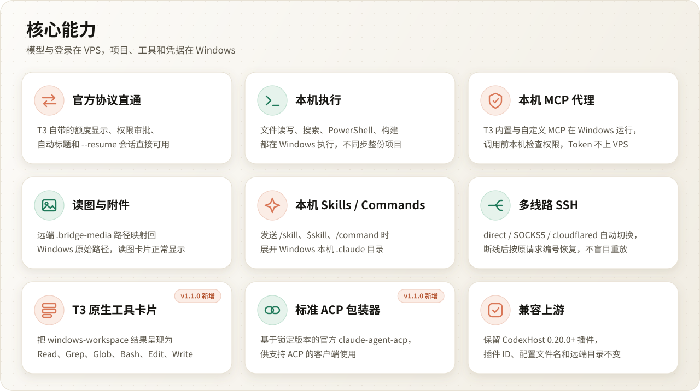
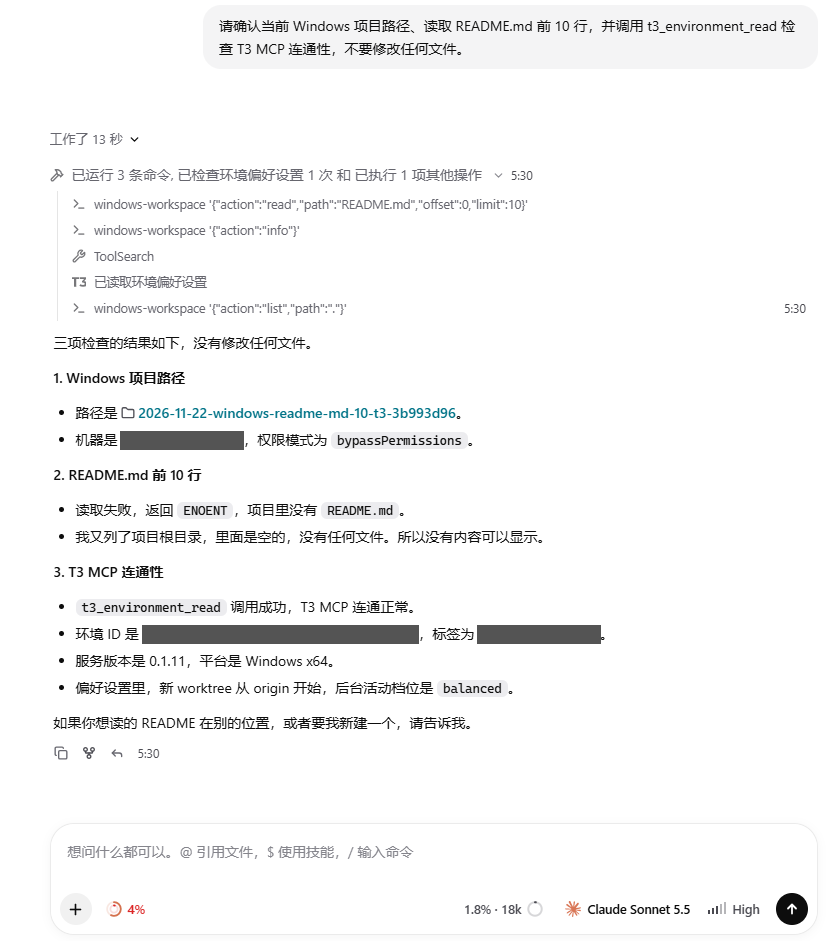
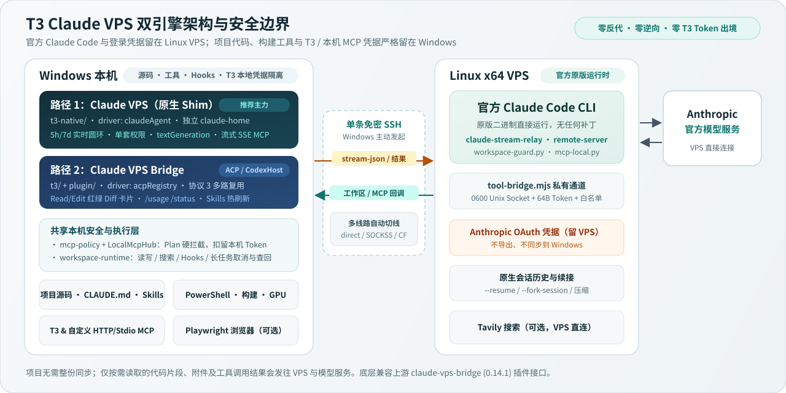

<p align="center">
  <picture>
    <source media="(prefers-color-scheme: dark)" srcset="docs/assets/banner-dark.svg">
    <source media="(prefers-color-scheme: light)" srcset="docs/assets/banner.svg">
    
  </picture>
</p>

<p align="center">
  
  <a href="https://github.com/vv-get-ti/claude-vps-bridge"></a>
  
  <a href="LICENSE"></a>
</p>

<p align="center">
  <a href="#简介">简介</a> &nbsp;·&nbsp;
  <a href="#快速开始">快速开始</a> &nbsp;·&nbsp;
  <a href="#工作原理">工作原理</a> &nbsp;·&nbsp;
  <a href="#与上游的区别">与上游的区别</a> &nbsp;·&nbsp;
  <a href="#文档">文档</a> &nbsp;·&nbsp;
  <a href="docs/FAQ.md">常见问题</a>
</p>

> [!NOTE]
> **本项目 fork 自 [`vv-get-ti/claude-vps-bridge`](https://github.com/vv-get-ti/claude-vps-bridge)**，基线为上游 `0.14.1`（`0acd8a0`）。
> 上游是 CodexHost 桌面端插件；本 fork 把同一套桥接接入 [T3 Code](https://github.com/pingdotgg/t3code)，可以不装 CodexHost 单独使用，同时保留上游的 CodexHost 插件。许可证沿用 LGPL-3.0-only。改了什么、没改什么，见 [Fork 说明](docs/FORK_CHANGES.md)。

## 简介

**让 Windows 上的 T3 Code 使用 VPS 上的官方 Claude Code：模型会话和登录态留在 VPS，源码、终端、编译器、GPU、浏览器和本地 MCP 留在 Windows。**

适合 Claude Code 的登录或网络环境放在 VPS、而代码和开发工具都在自己 Windows 电脑上的人。安装后，T3 Code 会多出一个独立的 Provider 实例 **`Claude VPS`**，选中即用，不改默认 `claudeAgent` 实例，不碰本机 `~/.claude`，也不改 T3 Code 的程序文件。

**为什么是 fork**：上游以 CodexHost 为前提。T3 Code 直接启动 Claude Code CLI 并通过 `stream-json` 通信，需要另加一层 Shim、VPS 端中继、MCP 代理和 Provider 注册，超出了上游插件的范围，因此单独维护；核心桥接沿用上游。

### 特性

<p align="center">
  <picture>
    <source media="(prefers-color-scheme: dark)" srcset="docs/assets/features-dark.svg">
    <source media="(prefers-color-scheme: light)" srcset="docs/assets/features.svg">
    
  </picture>
</p>

<details>
<summary>文字版特性清单</summary>

- **官方协议直通**：T3 自带的额度显示、权限审批、自动标题、`--resume` / fork 会话等可直接使用。
- **本机执行**：文件读写、搜索、PowerShell、构建、测试都在 Windows 按本机权限和项目规则执行，不同步整份项目到 VPS。
- **本机 MCP 代理**：T3 内置 MCP 与自定义 HTTP / Stdio MCP 在 Windows 运行，每次调用前在本机检查权限；T3 本地地址和 Token 不发到 VPS。
- **读图与附件**：远端 `.bridge-media` 路径映射回 Windows 原始路径，读图卡片正常显示。
- **本机 Skills / Commands**：发送 `/skill`、`$skill`、`/command` 时展开 Windows 本机 `.claude/{skills,commands}`。
- **多线路 SSH**：可配置 `direct` / SOCKS5 / `cloudflared` 线路自动切换，断线后按原请求编号恢复，不盲目重放。
- **T3 原生工具卡片**（v1.1.0 新增）：把 `windows-workspace` 结果呈现为 Read、Grep、Glob、Bash、Edit、Write 卡片。
- **标准 ACP 包装器**（v1.1.0 新增）：基于锁定版本的官方 `@agentclientprotocol/claude-agent-acp` 的薄包装，供支持 ACP 的客户端使用。
- **兼容上游**：保留 CodexHost 0.20.0+ 插件，插件 ID、配置文件名和远端目录不变。

</details>

> [!IMPORTANT]
> **验证范围**：v1.1.0 新增的 T3 原生工具卡片和标准 ACP 包装器目前只做过源码检查和隔离测试，尚未经过真实账号验收；源码与隔离测试通过不代表任何桌面环境已激活。本项目不声称兼容任意 T3 Code / CodexHost 版本，也不声称兼容所有原生 Claude 配置，不支持的配置会在诊断中说明。

### 不适合的情况

- 本机可以直接使用 Claude Code：用 T3 Code 自带的 Claude 即可。
- 要求项目内容完全不离开 Windows：Claude 读取的文件内容、命令输出和 MCP 返回值会传到 VPS，并可能进入模型请求（见[数据边界](#数据边界)）。

---

## 快速开始

### 1. 准备环境

- **Windows**：Node.js 24+、PowerShell 7、OpenSSH 客户端、Python 3.11+、npm、ripgrep（`rg`）、系统自带的 .NET Framework 4（`csc.exe`），以及至少打开过一次的 T3 Code。
- **Linux x64 VPS**：Python 3、Bash、Node.js 24，已安装并登录官方 [Claude Code](https://code.claude.com/docs/en/setup)；Windows 上配好免密 SSH 别名。

逐步说明（SSH 配置、VPS 登录）见[安装指南](docs/SETUP.md)。

### 2. 安装

在仓库根目录打开 **PowerShell 7**（独立模式，不需要 CodexHost）：

```powershell
# 生成配置：把 my-linux-host 换成你的 SSH 别名
python .\installer\configure.py --ssh-host my-linux-host --t3-only

# 部署桥接 + 中立 Shim + 注册 T3 Code 实例 Claude VPS
pwsh -NoProfile -File .\install.ps1 -T3Only

# 检查状态（不发起模型请求）
node .\t3-native\manage-native.mjs status
```

其他安装方式（`install.ps1` 的参数）：

| 参数 | 效果 |
|---|---|
| `-T3Only` | 只装 T3 接入，不需要 CodexHost |
| `-T3Only -WithAcp` | T3 接入 + 标准 ACP 包装器，共享同一 Shim |
| `-AcpOnly` | 只装标准 ACP 包装器，生成 `%USERPROFILE%\.claude-vps\acp\claude-vps-acp.exe`，用 `node .\acp\manage-acp.mjs status` 检查 |
| `-WithT3` | T3 Code 与 CodexHost 共存 |
| 无参数 | 只装 CodexHost 插件，与上游行为一致 |

### 3. 开始使用

1. 在 T3 Code 中打开一个 **Windows 本机项目**，新建会话。
2. 在模型选择器中选 **`Claude VPS`**；刚装完没出现时，到 **Settings → Providers** 刷新或重启 T3 Code。
3. 先发一条只读指令确认连通：

```text
请确认当前 Windows 项目路径、读取 README.md 前 10 行，并调用 t3_environment_read 检查 T3 MCP 连通性，不要修改任何文件。
```

<p align="center">
  
</p>

### 更新与卸载

- **更新**：拉取新版本后重新运行 `pwsh -NoProfile -File .\install.ps1 -T3Only`。
- **卸载 T3 接入**：先结束正在运行的 Claude VPS 会话，再运行 `pwsh -NoProfile -File .\uninstall.ps1`。这会移除 `Claude VPS` 实例，保留 `claude-home` 与会话数据；自定义 T3 数据目录时加 `-T3Home <目录>`。
- 诊断、升级、回滚和 ACP / Shim 的单独管理见[运维与排障](docs/OPERATIONS.md)。

<details>
<summary><b>CodexHost 模式：与 T3 Code 共存，或只装 CodexHost</b></summary>

<br>

保留上游的 CodexHost 0.20.0+ 插件，插件 ID（`claude-vps`）、配置文件名（`bridge-config.local.json`）和远端目录与上游一致。

```powershell
# T3 Code 与 CodexHost 共存
python .\installer\configure.py --ssh-host my-linux-host --host-root 'D:\Apps\CodexHost'
pwsh -NoProfile -File .\install.ps1 -WithT3

# 只装 CodexHost 插件（与上游行为一致）
pwsh -NoProfile -File .\install.ps1
```

安装或升级插件后，先运行 `codexhost stop` 再重新打开 CodexHost，然后运行 `node .\plugin\diagnose.mjs`，确认 `plugin-activation` 为 `current`。只关闭桌面窗口不会重新加载插件。

</details>

---

## 工作原理

<p align="center">
  <picture>
    <source media="(prefers-color-scheme: dark)" srcset="docs/assets/architecture-dark.svg">
    <source media="(prefers-color-scheme: light)" srcset="docs/assets/architecture.svg">
    
  </picture>
</p>

1. T3 Code 启动 `Claude VPS` 实例时，实际运行的是 Windows 上的 `claude-vps-shim.exe`。
2. Shim 经单条 SSH 连接 VPS 上的 `claude-stream-relay.mjs`，由它启动官方 `claude` CLI 并转发 `stream-json`。
3. Claude 读写文件或运行命令时调用 VPS 上的 `windows-workspace`，请求经同一条 SSH 回到 Windows，由本机按当前权限模式和项目规则执行。
4. MCP 调用同样回到 Windows，由本机连接服务或启动进程，并在 `tools/call` 前做权限检查。

### 数据边界

模型请求由 VPS 上的 Claude Code 发出，使用 VPS 上的登录状态。项目目录留在 Windows，但会话文字、附件，以及工具读取的文件内容、命令输出和 MCP 返回值，会随工具结果传到 VPS，并可能进入模型请求。获准执行的本机命令拥有 Windows 当前用户权限，工作区路径检查不等同于系统沙箱。

模块职责、恢复机制和协议细节见[架构与数据边界](docs/ARCHITECTURE.md)；T3 接入的能力矩阵、环境变量和排障见 [T3 Code 指南](docs/T3CODE.md)。

---

## 与上游的区别

| | 上游 `claude-vps-bridge` | 本 fork `t3-claude-vps` |
|---|---|---|
| 宿主 | CodexHost 0.20.0+ | T3 Code 原生接入、标准 ACP 包装，也可与 CodexHost 共存或只装 CodexHost |
| 必须安装 CodexHost | 是 | 否（`-T3Only`） |
| 接入层 | 无 | `shim/` 中立内核 + `t3-native/` 注册 + `acp/` 薄包装 |
| MCP | 本机 Playwright、VPS 端 Tavily | 另由 Windows 端代理 T3 内置与自定义 HTTP / Stdio MCP，并在本机检查权限 |
| 读图预览 | — | `.bridge-media` 路径映射回 Windows 原始路径 |
| 核心桥接（协议 3、工作区运行时、事务部署） | 原有 | 沿用上游，仅做向后兼容的加固 |
| 插件 ID、配置文件名、远端目录 | `claude-vps` / `bridge-config.local.json` / `~/.codexhost/windows-bridge` | 不变，可直接从上游迁移 |

完整清单与许可证义务见 [Fork 说明](docs/FORK_CHANGES.md)。T3 接入相关问题请在本仓库反馈；若在 CodexHost 模式下同样复现且与 T3 无关，通常来自上游代码，也可向[上游仓库](https://github.com/vv-get-ti/claude-vps-bridge)反馈。

---

## 文档

| 文档 | 内容 |
|---|---|
| [安装指南](docs/SETUP.md) | 环境准备、免密 SSH、VPS 登录与部署方式 |
| [T3 Code 指南](docs/T3CODE.md) | 能力矩阵、MCP 权限检查、读图路径映射与排障 |
| [配置说明](docs/CONFIGURATION.md) | 配置文件、多条 SSH 线路、可选工具（Tavily / Playwright） |
| [架构与数据边界](docs/ARCHITECTURE.md) | 模块职责、传输协议 3、锁与恢复机制、数据去向 |
| [运维与排障](docs/OPERATIONS.md) | 统一诊断、升级与回滚、日志清理、卸载 |
| [附件支持](docs/ATTACHMENTS.md) | 图片、PDF 与视频的处理方式和大小限制 |
| [扩展接口](docs/EXTENDING.md) | 新增可选工具时的要求 |
| [Fork 说明](docs/FORK_CHANGES.md) | 上游基线、差异、同步策略 |
| [常见问题](docs/FAQ.md) | 与上游的关系、安全性和常见故障 |
| [更新记录](CHANGELOG.md) | 本 fork 的发布记录与保留的上游历史 |

### 可选：界面增强

[T3 Code Enhancer](https://github.com/Barometer-2002/t3code-enhancer) 是另一个独立项目，为 T3 Code 提供主题、工作过程折叠和用量统计等界面增强，不是本桥接运行所必需的；安装与版本兼容性见该项目自己的 README。

---

## 仓库结构

```text
shim/        [fork 新增] 中立 Shim 内核：C# 启动器、Node stream-json 代理、本机 MCP 代理与权限策略、工具卡片呈现
t3-native/   [fork 新增] T3 Code 原生实例注册管理（manage-native.mjs）
acp/         [fork 新增] 标准 ACP 薄包装（复用锁版本官方 claude-agent-acp）
remote/      VPS 端运行时：claude-stream-relay（fork 新增）、remote-server、tool-bridge、workspace-guard、mcp-local
plugin/      Windows 端核心桥接与 CodexHost 插件：协议 3 传输、工作区执行、Hooks、诊断
installer/   配置器、依赖准备、事务式部署与回滚
docs/        使用指南、架构文档与图示（docs/assets/）
examples/    配置示例（全部为占位值）
scripts/     源码语法检查与公开内容检查
install.ps1  uninstall.ps1  安装与卸载入口
```

---

## 贡献、安全与许可

提交改动前请阅读 [CONTRIBUTING.md](CONTRIBUTING.md) 和 [AGENTS.md](AGENTS.md)，并确认检查通过：

```powershell
python .\scripts\check.py
python .\scripts\check-public.py --staged
```

安全问题和公开资料要求见 [SECURITY.md](SECURITY.md)。

- **许可证**：[LGPL-3.0-only](LICENSE)，与上游一致（随附 [GPL-3.0 全文](LICENSE-GPL-3.0)）。上游来源和第三方依赖见 [THIRD_PARTY_NOTICES.md](THIRD_PARTY_NOTICES.md)。本仓库不分发 Claude Code、T3 Code 或 CodexHost 的二进制文件、账号或凭据，它们各自的条款不受影响。
- **致谢**：上游 **[vv-get-ti/claude-vps-bridge](https://github.com/vv-get-ti/claude-vps-bridge)** 提供了核心桥接；同时感谢 **[T3 Code](https://github.com/pingdotgg/t3code)**、**[CodexHost](https://github.com/BytePioneer-AI/codex-host)** 与官方 **[claude-agent-acp](https://www.npmjs.com/package/@agentclientprotocol/claude-agent-acp)**。
- **友情链接**：[LINUX DO](https://linux.do/)
