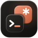

<p align="center">
  
</p>

<h1 align="center">T3 Claude VPS (<code>t3-claude-vps</code>)</h1>

<p align="center">让 Linux VPS 上的官方 Claude Code 原生接入 Windows 端 T3 Code —— 凭据留 VPS，代码、工具与 T3 Token 留本机。</p>

<p align="center">
  <a href="#快速开始t3-code">快速开始</a> ·
  <a href="docs/FORK_CHANGES.md">Fork 与改进说明</a> ·
  <a href="docs/T3CODE.md">T3 Code 深度指南</a> ·
  <a href="docs/SETUP.md">安装指南</a> ·
  <a href="docs/CONFIGURATION.md">配置</a> ·
  <a href="docs/ARCHITECTURE.md">架构</a> ·
  <a href="docs/FAQ.md">常见问题</a>
</p>

> **Fork 声明（LGPL-3.0-only）**：**T3 Claude VPS** 是基于上游项目 [`vv-get-ti/claude-vps-bridge`](https://github.com/vv-get-ti/claude-vps-bridge)（基线 `0.14.1` / `0acd8a0`）开发的深度增强分支。本项目严格遵循上游 **LGPL-3.0-only** 许可证，完整保留上游的 SSH 多路传输、Windows 工作区运行时与 CodexHost 插件兼容性，并面向 **[T3 Code](https://github.com/pingdotgg/t3code)** 新增了**官方 `claudeAgent` 原生 Shim**、**深度 Local ACP v2 适配器** 与 **纯 T3 独立安装模式**。详见 [Fork 起源与完整改进说明](docs/FORK_CHANGES.md)。

---

## 本 Fork 相对上游的核心改进

| 维度 | 上游 `claude-vps-bridge`（`0.14.1`） | 本 Fork：**T3 Claude VPS**（`t3-claude-vps`） |
|---|---|---|
| **目标宿主** | CodexHost 桌面端插件 | **T3 Code 优先**（双引擎接入 + 纯 T3 独立安装），同时 **100% 兼容 CodexHost** |
| **T3 Code 官方原生接入** | 无 | 新增 `t3-native/`（**`Claude VPS`**，`driver: claudeAgent`）：直通 VPS 官方 `stream-json`，解锁**顶部 5h/7d 实时额度圆环**、单套原生权限、`textGeneration`、`effort`/`ultracode`/`fastMode`、缓存过期自动压缩、隔离 `claude-home` |
| **T3 Code Local ACP 适配** | 无 | 新增 `t3/` v1.3.1（**`Claude VPS Bridge`**，`driver: acpRegistry`）：原生 `Read`/`List`/`Grep`/`Edit`(红绿 Diff)/`PowerShell` 卡片、可读审批弹窗、跨轮 Plan 面板、`ExitPlanMode`、零消耗 `/usage` & `/status`、热刷新 `$skill`/`/command` |
| **T3 内置 MCP 生态直通** | 无 | 双路径均打通 `mcp__t3-code__*`（`preview_*`、`html_render`、`delegate_task`、`t3_thread_*` 等）；T3 本地 `127.0.0.1` URL 与 Bearer Token 严格留在 Windows，ACP 侧带会话精确隔离与 Plan 模式 Fail-Closed 只读白名单 |
| **纯 T3 独立安装** | 需依赖 CodexHost 安装目录 | 新增 `--t3-only` / `-T3Only` / `-WithT3` / `-WithT3Native`，无需安装 CodexHost 桌面端即可运行 |
| **VPS 守卫与并发体验** | 简写命令走 `updatedInput` 改写 | 移除全部 `updatedInput` 改写修复 `auto` 模式并发拒批；放行 `ToolSearch`、任务工具与 `ExitPlanMode`；过滤 PowerShell CLIXML 噪音 |

完整修改对照与底层兼容边界见 [docs/FORK_CHANGES.md](docs/FORK_CHANGES.md)。

---

## 两种 T3 Code 接入方式（可独立并存）

两者均**不修改 T3 Code 默认 `claudeAgent` 实例、不触碰本机 `~/.claude`、不修改 T3 Code 任何程序文件**，可与本机原生 Claude 账号完全并行使用：

| 方案 | T3 内显示名 | 驱动类型 | 核心特点与推荐场景 |
|---|---|---|---|
| **官方 `claudeAgent` 原生 Shim**（`t3-native/`，推荐主力） | **`Claude VPS`** | `claudeAgent` | 直通 VPS 原版 Claude Code 标准 `stream-json`：顶部 5h/7d 实时额度圆环、单套原生权限（`can_use_tool`）、自动标题/Commit/PR（`textGeneration`）、`effort`/`ultracode`/`fastMode`、缓存过期自动压缩、支持 `ToolSearch` 延迟加载全部 T3 MCP 工具。 |
| **Local ACP 适配器**（`t3/`，v1.3.1） | **`Claude VPS Bridge`** | `acpRegistry` | 将 `windows-workspace` 自动解包并翻译为原生 `Read`/`List`/`Grep`/`Edit`（红绿 Diff）/`PowerShell` 卡片与可读审批弹窗；支持零消耗 `/usage` & `/status`、本机 `.claude/{skills,commands}` 补全热刷新与真执行、Plan 模式 Fail-Closed MCP 白名单。 |

详细能力对比、架构图与可选安全环境变量见 [T3 Code 适配与使用指南](docs/T3CODE.md)。

---

## 快速开始（T3 Code）

### 1. 准备两端环境

| Windows 本机 | Linux x64 VPS |
|---|---|
| T3 Code、Node.js 24+、PowerShell 7、OpenSSH 客户端、Python 3.11+、npm、ripgrep（`rg`）、Windows 内置 .NET Framework 4（`csc.exe`） | Python 3、Bash、Node.js 24/npm、已登录的官方 Claude Code |

先在 VPS 上安装并登录 [Claude Code](https://code.claude.com/docs/en/setup)，并在 Windows 配好指向 VPS 的免密 SSH 别名（详细步骤见 [安装指南](docs/SETUP.md)）。Windows 本机无需安装或登录 Claude Code，也无需开启 Windows SSH 服务。

### 2. 一键部署（无需 CodexHost 桌面端）

在仓库根目录打开 **PowerShell 7**：

```powershell
# 1. 生成连接配置（将 my-linux-host 替换为你的 SSH 别名）
python .\installer\configure.py --ssh-host my-linux-host --t3-only

# 2. 部署两端桥接并注册原生 Claude VPS（推荐）与 ACP Claude VPS Bridge
pwsh -NoProfile -File .\install.ps1 -T3Only -WithT3Native
```

> 若只需要 ACP 适配器，去掉 `-WithT3Native` 即可；两端桥接就位后也可通过 `node .\t3-native\manage-native.mjs` 与 `node .\t3\manage.mjs` 单独安装、查状态或卸载。

### 3. 在 T3 Code 中使用与验收

1. 在 T3 Code 打开任意 **本机 Windows 项目**，新建会话。
2. 在模型选择器中选择 **`Claude VPS`**（原生 Shim）或 **`Claude VPS Bridge`**（ACP 适配器）。
3. 发一条只读指令验收（原生模式可顺便观察顶部/账号页 5h & 7d 实时额度圆环）：

```text
请确认当前 Windows 项目路径、读取 README.md 前 10 行，并调用 t3_environment_read 检查 T3 MCP 连通性，不要修改任何文件。
```

---

## 工作原理与安全边界


- **官方标准协议，零反代零逆向**：VPS 上始终运行原版官方 `claude` CLI，所有 Anthropic 请求由 VPS 直接发出；Anthropic OAuth 凭据与原生会话留在 VPS，不搬运到 Windows。
- **代码与本机凭据留在 Windows**：项目目录留在 Windows，VPS Claude 通过 `windows-workspace` 经既有认证 SSH 双向通道按需读写和执行命令；T3 Code 本地 `127.0.0.1` HTTP MCP 地址与 Bearer Token 严格留在 Windows 进程内存，永不发往 VPS。
- **沿用本机开发配置**：自动加载 `CLAUDE.md`、`AGENTS.md`、`.claude/rules`、Skills/Commands 与支持的 Hooks / 权限策略；支持多条 SSH 线路（`direct` / SOCKS5 / `cloudflared`）自动故障切换。

详见 [架构与数据边界](docs/ARCHITECTURE.md) 与 [T3 Code 适配与使用指南](docs/T3CODE.md)。

---

## 上游完整兼容（CodexHost 桌面端）

本 Fork 完整保留了上游 `vv-get-ti/claude-vps-bridge` 的 CodexHost 0.20.0+ 插件能力；为避免破坏已有安装配置、项目映射与历史会话，底层插件 ID（`claude-vps`）、配置文件名（`bridge-config.local.json`）与远端目录结构保持与上游兼容。

如需与 CodexHost 双宿共存或仅使用 CodexHost：

```powershell
# T3 Code（双模式）+ CodexHost 共存
python .\installer\configure.py --ssh-host my-linux-host --host-root 'D:\Apps\CodexHost'
pwsh -NoProfile -File .\install.ps1 -WithT3 -WithT3Native

# 仅安装 CodexHost 插件
pwsh -NoProfile -File .\install.ps1
```

> CodexHost 插件由共享后台加载，安装或升级后需执行 `codexhost stop` 再重新打开 CodexHost，并用 `node .\plugin\diagnose.mjs` 确认 `plugin-activation` 为 `current`。

---

## 文档导航

| 文档 | 内容说明 |
|---|---|
| [Fork 起源与改进说明](docs/FORK_CHANGES.md) | 上游基线、LGPL-3.0 声明、五大核心改进与变更文件全览 |
| [T3 Code 适配与使用指南](docs/T3CODE.md) | 原生 `claudeAgent` Shim 与 Local ACP 对比、双路径架构图、安装、安全策略与排障 |
| [安装指南](docs/SETUP.md) | 环境准备、免密 SSH、VPS 登录 Claude、T3 独立/双宿部署与验收 |
| [配置说明](docs/CONFIGURATION.md) | `CLAUDE.md`、`.claude` 规则/Skills/Hooks、权限策略、多 SSH 线路与可选 MCP |
| [架构与数据边界](docs/ARCHITECTURE.md) | 模块职责、传输协议 3、锁与恢复机制、数据流边界 |
| [运维与排障](docs/OPERATIONS.md) | 统一诊断、T3 状态与独立卸载、日志清理、升级与回滚 |
| [附件支持](docs/ATTACHMENTS.md) | 图片、PDF 与视频文件的处理方式与大小限制 |
| [常见问题](docs/FAQ.md) | T3 Code 选型、安全性、Fork 关系与高频排障问答 |
| [更新记录](CHANGELOG.md) | 本 Fork 变更日志与上游基线历史 |

---

## 项目结构

```text
t3-native/     [Fork 新增] T3 Code 官方 claudeAgent 原生 Shim（C# 启动器、Node 代理、本地 HTTP MCP 客户端与注册工具）
t3/            [Fork 新增] T3 Code Local ACP v2 适配器（v1.3.1，工具卡片翻译、MCP-over-ACP、Plan 面板与管理工具）
remote/        VPS 端运行时（含 Fork 新增 claude-stream-relay.mjs，以及上游 remote-server / tool-bridge / workspace-guard / mcp-local）
plugin/        Windows 本机核心桥接与 CodexHost 插件运行时（SSH 协议 3 多路传输、工作区执行、项目环境、Hooks、诊断）
installer/     配置（支持 --t3-only）、依赖准备、事务式部署/回滚与停用脚本
docs/          Fork 改进说明、T3 Code 指南、安装、配置、架构、运维与 FAQ
examples/      配置示例
scripts/       源码语法与公开仓库安全检查
```

---

## 参与贡献

提交改动前请阅读 [贡献指南](CONTRIBUTING.md) 与 [AGENTS.md](AGENTS.md)，并确保以下两项检查全部通过：

```powershell
python .\scripts\check.py
python .\scripts\check-public.py --staged
```

扩展工具可参考 [扩展接口](docs/EXTENDING.md)，安全问题请参见 [安全说明](SECURITY.md)。

---

## 许可证与致谢

- 本项目继续采用与上游一致的 **[LGPL-3.0-only](LICENSE)**（随附 [GPL-3.0 全文](LICENSE-GPL-3.0)）。第三方组件、上游项目与图形授权详见 [第三方声明](THIRD_PARTY_NOTICES.md)。
- 衷心感谢上游项目 **[vv-get-ti/claude-vps-bridge](https://github.com/vv-get-ti/claude-vps-bridge)**（基线 `0.14.1`）提供稳健的 SSH 协议 3 多路复用传输、Windows 本机工作区运行时、事务部署与项目环境体系。
- 感谢 **[CodexHost](https://github.com/BytePioneer-AI/codex-host)** 与 **[T3 Code](https://github.com/pingdotgg/t3code)** 生态，以及 [LobeHub Icons](https://github.com/lobehub/lobe-icons) 提供 Clawd 轮廓图形。
