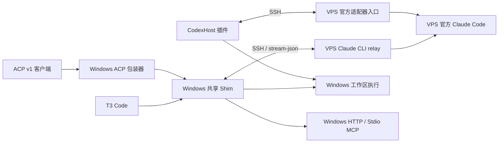

# 架构与数据流

Claude Code 在 VPS 负责模型请求和原生会话管理。桥接把受支持的项目操作送回 Windows 执行，并把结果返回 VPS。T3 和 ACP 使用不同的 Windows 客户端入口，两者共用 Shim、VPS Claude CLI relay 和 Windows 工作区实现。

## 整体架构

## 各模块职责

| 源码位置 | 做什么 |
| --- | --- |
| `t3-native/manage-native.mjs` | 在 T3 用户配置中安装、检查或移除受管 Provider。 |
| `acp/` | 启动锁定版本的上游 ACP Agent，收窄 ACP v1 能力，转换工作区事件和审批预览。 |
| `shim/` | 启动并转发 Claude CLI 流，适配本机 MCP、工具卡片和附件路径。ACP 续接时，启动前在 VPS 核对旧会话是否属于当前 Windows 工作区。 |
| `remote/claude-stream-relay.mjs` | 在 VPS 启动官方 Claude CLI 和工作区工具通道，合并宿主附加提示和桥接说明。 |
| `plugin/`、`remote/remote-server.mjs` | CodexHost 的 Harness 接口与远端受管适配器。 |
| `plugin/runtime/`、`remote/tool-bridge.mjs` | 执行本机工作区操作，处理任务、路径、项目规则、权限、MCP 与写入协调。 |
| `installer/` | 发现依赖、准备两端文件、校验部署、记录并恢复事务。 |

## 项目身份与权限

真实 Windows 路径和机器标识用于生成项目身份。会话和工具请求都绑定该身份。VPS 维护协调目录，文件读写仍由 Windows 执行。

`plugin/runtime/workspace-request-schema.json` 定义工作区动作。VPS 先检查结构，Windows 在执行前重新校验字段、权限和路径。写入可要求内容哈希，项目规则和 Hooks 参与执行检查。写入协调覆盖桥接的结构化编辑、命令生命周期及受管委派。未知任务仍可能持有锁，外部程序对同一目录的写入需要另外核对。

本机执行器按需启动，以独立命名管道管理任务。命令输出完整保存在本机，状态预览每路最多 64 KiB。搜索先检查逐文件权限，完整结果保存在本机快照并分页读取。旧日志由 [维护命令](OPERATIONS.md#日志清理) 清理。

## 连接中断与恢复

| 路径 | 行为 |
| --- | --- |
| **CodexHost** | 桥接协议 3 的持久 relay，消息有请求编号和确认游标。大响应分块发送，小响应可插队。重连后按游标恢复并去重。relay 消失或保留范围耗尽时，操作结果可能未知。 |
| **T3 / ACP** | Shim 启动 VPS `stream-json` relay，启动时可尝试备用线路。SSH 中断时保留可查询的本机任务编号，随后核对任务与原生会话状态。 |

远端适配器最低版本和桥接协议见 [依赖策略](../installer/dependency-policy.json)。

## 数据存放

| 数据 | 位置 |
| --- | --- |
| 项目文件、搜索快照、任务日志 | Windows。读取返回的片段会经过 VPS，可能进入模型请求。 |
| 对话、规则、附件 | 作为模型输入经 VPS。VPS 保存原生会话和桥接缓存，客户端也可能保存聊天数据。 |
| Claude 登录 | VPS 上的官方 Claude Code 管理。VPS 的 CLI 和环境决定账号与模型服务。 |
| 本机 MCP | 连接配置在 Windows 使用。工具的调用参数和结果可经桥接传输。 |
| 安装配置与事务 | Windows 保留已部署配置和事务记录，VPS 保留远端配置和受管文件清单。 |

图片和 PDF 按会话与哈希缓存，复用前核对权限与内容。详见 [附件指南](ATTACHMENTS.md)。
