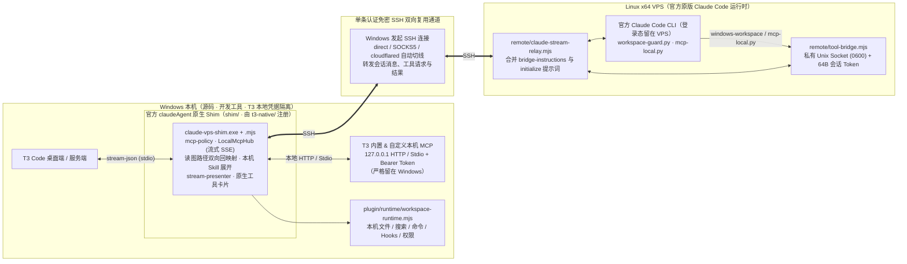

# T3 Code 适配与使用指南

T3 Code 接入是本 fork 相对上游 [`claude-vps-bridge`](https://github.com/vv-get-ti/claude-vps-bridge) 新增的部分（见 [Fork 说明](FORK_CHANGES.md)）。它让 Windows 上的 [T3 Code](https://github.com/pingdotgg/t3code) 直接使用 VPS 上的官方 Claude Code，项目文件和工具留在 Windows，不需要安装 CodexHost。

安装后，T3 Code 中会多出一个独立实例 **`Claude VPS`**（`id: claude-vps`，`driver: claudeAgent`），使用单独的 `homePath`（`claude-home`）。它不修改默认 `claudeAgent` 实例，不碰本机 `~/.claude`，不修改 T3 Code 的程序文件，可以和本机自带的 Claude 同时使用。底层的 SSH 传输和 Windows 工作区运行时与 CodexHost 模式共用，来自上游。

---

## 一、核心能力矩阵

| 能力维度 | `Claude VPS`（官方 `claudeAgent` 原生 Shim） |
|---|---|
| **T3 驱动类型** | `claudeAgent`（T3 内置官方 Claude 驱动，直通 `stream-json`） |
| **顶部 5h / 7d 实时额度圆环** | **原生支持并实时跳变**（直通 `get_usage` + `rate_limit_event`） |
| **权限体系** | **单套原生权限**（T3 Supervised / Auto-accept / Full-access 直通 `can_use_tool`） |
| **内置 `textGeneration`** | **原生支持**（自动标题、Commit、PR 描述、PR Review Guide） |
| **模型与高级参数** | 完整模型目录 + `effort` / `ultracode` / `fastMode` / `autoCompactWindow` / `beforeCacheExpires` + `--resume` / `--fork-session` |
| **T3 与本机自定义 MCP** | 拦截 `--mcp-config` 与动态 `mcp_set_servers`，在 Windows 本机运行 Streamable HTTP（流式逐事件 SSE）与 Stdio MCP，支持 `ToolSearch` 延迟加载 |
| **本机工作区与读图渲染** | 原生 `Bash`（`windows-workspace`）+ 零改写 PreToolUse 守卫 + 本机 Hooks；`windows-workspace media` 导出后自动将远端 `.bridge-media` 路径回映射为 Windows 原始路径，保障 T3 读图预览渲染与审批弹窗双向还原 |
| **原生工具卡片** | `shim/stream-presenter.mjs` 把 `windows-workspace` 的读取、搜索、列目录、命令和编辑结果呈现为 T3 原生的 Read、Grep、Glob、Bash、Edit、Write 卡片，Edit / Write 带本机生成的 diff；非 workspace 的 Bash 保持原样 |
| **Plan 任务面板与审批** | 原生 `TaskCreate` / `TaskUpdate` / `TodoWrite` / `ExitPlanMode` / `EnterPlanMode` |
| **本机 Skills / Commands** | 发送 `/skill`、`$skill` 或 `/command` 时自动识别并展开 Windows 本机 `.claude/{skills,commands}`（替换 `$ARGUMENTS`，不劫持内置命令） |
| **SSH 多线路与任务恢复** | 启动时支持 `sshRoutes` 多线路自动故障切换（`cloudflared` / `socks5` / `direct`）；停止会话自动取消本机长任务，SSH 意外断线自动保留原 `requestId` 防重放 |

---

## 二、架构与安全边界



### 明确的数据与安全边界

- **VPS 端**使用 VPS 上的 Claude Code 配置和登录会话，发起模型请求并保存原生会话记录。
- **Windows 端**执行项目读写和命令。MCP 代理用本机的 `url`、`headers` 和 `env` 配置连接 HTTP 服务或启动 Stdio 进程，VPS 端接收对应的代理入口。
- **SSH 传输**包括对话正文、发送的附件、工具请求及返回的数据。文件内容、命令输出和 MCP 返回值（如 `t3_thread_read` 读出的文本）可能进入模型请求。
- **MCP 调用检查**在 Windows 端进行。`shim/mcp-policy.mjs` 在收到 `tools/call` 时检查权限模式、`T3_MCP_ALLOW_TOOLS` / `T3_MCP_DENY_TOOLS` 与项目的 `permissions.deny`。Plan 模式按只读白名单和自定义工具声明的 `readOnlyHint`、`destructiveHint` 筛选调用。

---

## 三、环境要求

- **Windows 10/11**：Node.js 24+、PowerShell 7、OpenSSH 客户端、Python 3.11+、npm、ripgrep（`rg`）、Windows 内置 .NET Framework 4（`csc.exe`，用于编译轻量启动器 `claude-vps-shim.exe`）。
- **T3 Code**：已安装并至少打开过一次以生成 `%USERPROFILE%\.t3\userdata\settings.json`。
- **Linux x64 VPS**：已安装并登录官方 Claude Code，配置好免密 SSH 别名（见 [安装指南](SETUP.md) 第 1–3 步）。

---

## 四、安装、更新与卸载

### 方式一：仅使用 T3 Code（推荐，无需安装 CodexHost 桌面端）

在仓库根目录打开 PowerShell 7：

```powershell
# 1. 生成连接配置（将 my-linux-host 替换为你的 SSH 别名）
python .\installer\configure.py --ssh-host my-linux-host --t3-only

# 2. 部署两端 Bridge + 注册原生实例 Claude VPS
pwsh -NoProfile -File .\install.ps1 -T3Only
```

### 方式二：与 CodexHost 共存安装

```powershell
python .\installer\configure.py --ssh-host my-linux-host --host-root 'D:\Apps\CodexHost'
pwsh -NoProfile -File .\install.ps1 -WithT3
```

### 单独安装、状态检查与卸载

两端 Bridge 已就位时，可独立管理 T3 原生接入（绝不改动默认 `claudeAgent`）：

```powershell
# 原生 claudeAgent Shim（实例 ID: claude-vps，显示名: Claude VPS）
node .\t3-native\manage-native.mjs install
node .\t3-native\manage-native.mjs status
node .\t3-native\manage-native.mjs uninstall
```

- `manage-native.mjs install` 支持先在独立暂存目录编译并执行离线 `--self-test` 与远端 `--version --live` 实时探针校验，通过后再原子热替换（Windows 下即使有旧会话在跑 `.exe` 也可安全热升级），失败自动回滚不破坏旧安装。
- `manage-native.mjs status` 明确区分 `cachedVersion`、`liveCheck` 与 `offlineSelfTest`；如需离线快速检查，可加 `--offline`。
- 自定义 T3 数据目录时，可设置 `T3CODE_HOME` 或追加 `--t3-home <目录>` / `-T3Home <目录>`。

---

## 五、开始使用与验收

1. 在 T3 Code 打开一个 **本机 Windows 项目**，新建会话。
2. 在模型选择器中选择 **`Claude VPS`**。若刚安装完尚未显示，可在 **Settings → Providers** 刷新或重启 T3 Code。
3. 推荐按下面 3 条快速验收：
   - **额度与本机读写**：查看顶部/账号页 5h & 7d 实时额度圆环是否亮起，并让它读取本机文件 + 调用 `t3_environment_read` 确认本机与 T3 MCP 全通。
   - **图片预览渲染**：让它读取项目中的一张本地 PNG/JPG 图片，确认 Claude 正常看懂图片且 T3 Code 的读图卡片正常渲染预览（无裂图）。
   - **并发与 Plan 验证**：在 `auto` 模式下让它同时读文件并跑一条命令，或创建 2–3 步待办确认任务进度面板实时更新。

日常使用由 T3 Code 按需拉起，无需常驻任何额外后台程序。

---

## 六、可选环境变量配置

可在 `%USERPROFILE%\.t3\userdata\settings.json` 对应 `claude-vps` Provider 实例的环境变量（或系统环境）中按需设置：

| 变量 | 说明 |
|---|---|
| `T3CODE_HOME` | 自定义 T3 Code 数据目录（默认 `%USERPROFILE%\.t3`）。 |
| `CLAUDE_VPS_NODE` | 显式指定 `claude-vps-shim.exe` 调用的 `node.exe` 路径。 |
| `T3_MCP_ALLOW_TOOLS` | 逗号分隔的 `t3-code` MCP 工具白名单（设置后仅暴露并放行列表内工具）。 |
| `T3_MCP_DENY_TOOLS` | 逗号分隔的 `t3-code` MCP 工具黑名单（例如 `request_secret,schedule_task`）。 |

---

## 七、常见排障

| 现象 | 排查方式 |
|---|---|
| `Claude VPS` 提示未安装或版本探测失败 | 运行 `node .\t3-native\manage-native.mjs status`；确认 `liveCheck.ok` 为 `true`，并用 `node .\plugin\diagnose.mjs` 检查 SSH 连通性。 |
| `t3-code` MCP 未连通或工具列表为空 | 确认两端已通过最新版 `install.ps1 -T3Only`（或 `-WithT3`）同步部署，保证 VPS 端 `remote/claude-stream-relay.mjs` 与 `remote/workspace-guard.py` 均为最新版本。 |
| 读图卡片无法预览或路径显示为 `/home/.../.bridge-media/...` | 重新运行 `pwsh -NoProfile -File .\install.ps1 -T3Only`（或 `node .\t3-native\manage-native.mjs install`）确保两端已升级到 `v1.0.0` 及以上，启用远端读图路径自动回映射。 |
| 重装或升级后旧会话如何保留 | `uninstall` 默认保留 `%USERPROFILE%\.t3\integrations\claude-vps-native\claude-home` 与 `runtime/state/media-path-cache.json`，重装后可直接 `--resume` 续接。 |
