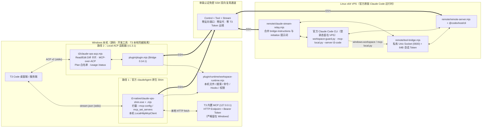

# T3 Code 适配与使用指南

本仓库为 Windows 端 [T3 Code](https://github.com/pingdotgg/t3code) 提供**两种可独立并存的 VPS Claude Code 接入方案**，均与 CodexHost 共用同一套本机与 VPS 桥接基础设施，且支持**纯 T3 Code 独立安装（无需安装 CodexHost 桌面端）**：

1. **官方 `claudeAgent` 原生 Shim（`t3-native/`，推荐）** — 注册独立实例 **`Claude VPS`**（`driver: claudeAgent`），通过 SSH 直通 VPS 原版 Claude Code 的官方 `stream-json` 协议。
2. **Local ACP 适配器（`t3/`，v1.3.1）** — 注册独立实例 **`Claude VPS Bridge`**（`driver: acpRegistry`），通过 ACP v2 协议接入并深度翻译本机工具卡片与状态命令。

两者均**不修改 T3 Code 默认 `claudeAgent` 实例、不修改本机 `~/.claude`、不修改 T3 Code 任何程序文件**，可与本机原生 Claude 账号完全并行共存。

---

## 一、两种接入方案对比

| 能力维度 | 原生 `claudeAgent` Shim（`Claude VPS`） | Local ACP 适配器（`Claude VPS Bridge`） |
|---|---|---|
| **T3 驱动类型** | `claudeAgent`（官方一等公民驱动） | `acpRegistry`（通用本地 ACP 驱动） |
| **顶部 5h / 7d 实时额度圆环** | **原生支持并实时跳变**（直通 `get_usage` + `rate_limit_event`） | 不支持圆环（以零消耗 `/usage` + ≥90% `notice` 替代） |
| **权限体系** | **单套原生权限**（T3 Supervised / Auto-accept / Full-access 直通 `can_use_tool`） | 两套叠加（T3 审批开关 + `Claude Mode` 下拉，可隐藏后者） |
| **内置 `textGeneration`** | **原生解锁**（自动标题、Commit、PR 描述、PR Review Guide） | T3 对 `acpRegistry` 硬编码关闭 |
| **模型与高级参数** | 完整 14 模型 + `effort` / `ultracode` / `fastMode` / `autoCompactWindow` / `beforeCacheExpires` | 完整模型目录 + 按模型过滤 `Thinking` 档位 |
| **T3 原生 MCP 工具直通** | **支持**（拦截 `mcp_set_servers` / `--mcp-config`，本机 `LocalHttpMcpClient` 直连 `127.0.0.1`，支持 `ToolSearch` 延迟加载） | **支持**（MCP-over-ACP，按 `acpSessionId` 严格隔离，Plan 模式 Fail-Closed 只读白名单） |
| **本机工具卡片展示** | 原生 `Bash`（`windows-workspace`）+ 完整 PreToolUse 守卫与本机 Hooks | 自动解包并翻译为原生 `Read` / `List` / `Grep` / `Edit`(红绿 Diff) / `PowerShell` / `Batch` 卡片与可读审批弹窗 |
| **Plan 任务面板与审批** | 原生 `TaskCreate` / `TaskUpdate` / `TodoWrite` / `ExitPlanMode` | 全量同步至 ACP `plan` 面板（跨轮持久 + `session/load` 重建）与 `elicitation/create` |
| **本机 Skills / Commands** | 随本机项目上下文注入，支持 `windows-workspace capability` | 自动扫描 `~/.claude` 与 `.claude/{skills,commands}` 注入 T3 补全菜单，每轮自动热刷新，点击 `$skill` / `/command` 真执行 |
| **适合场景** | 日常主力（追求顶部实时额度、单套权限、自动 Commit/PR 等完整官方体验） | 偏爱原生 `Read`/`Edit` Diff 工具卡片、`/usage` & `/status` 诊断或作为稳定后备 |

---

## 二、架构与安全边界



### 明确的数据与安全边界

- **严格留在 VPS（不搬运到 Windows）**：Anthropic OAuth 登录凭据、VPS `~/.claude` 配置与原生会话记录；所有 Anthropic API 请求由 VPS 原版 Claude Code 直接发出（零反代、零逆向）。
- **严格留在 Windows（不发往 VPS）**：本机环境变量中的 API Key/凭据、T3 Code 本地 `127.0.0.1` HTTP MCP 地址与 `Authorization` Bearer Token、以及项目源码目录本身。
- **会发往 VPS 供模型推理**：对话正文、粘贴的图片/附件、Claude 主动读取的文件片段、命令输出，以及调用 T3 MCP 工具时的参数与返回值（例如 `t3_thread_read` 读出的文本）。
- **ACP 模式的 T3 MCP 策略边界**：`mcp__t3-code__*` 不经过 Windows 工作区 `preflight`，由本机 ACP 适配器执行 **Plan 模式 Fail-Closed 只读白名单**（默认拦截所有变更/启动/取消类及未来新增工具）与可选 `T3_MCP_ALLOW_TOOLS` / `T3_MCP_DENY_TOOLS`，再叠加 Claude/T3 审批。ACP 通道支持 Claude → T3 的请求与通知，不反向推送服务端主动通知（如 `tools/list_changed`），连接中断后自动重连。

---

## 三、环境要求

- **Windows 10/11**：Node.js 24+、PowerShell 7、OpenSSH 客户端、Python 3.11+、npm、ripgrep（`rg`）、Windows 内置 .NET Framework 4（`csc.exe`，用于编译轻量启动器 `claude-vps-shim.exe`）。
- **T3 Code**：已安装并至少打开过一次以生成 `%USERPROFILE%\.t3\userdata\settings.json`。
- **Linux x64 VPS**：已安装并登录官方 Claude Code，配置好免密 SSH 别名（见 [安装指南](SETUP.md) 第 1–3 步）。

---

## 四、安装、更新与卸载

### 方式一：仅使用 T3 Code（无需安装 CodexHost 桌面端）

在仓库根目录打开 PowerShell 7：

```powershell
# 1. 生成连接配置（将 my-linux-host 替换为你的 SSH 别名）
python .\installer\configure.py --ssh-host my-linux-host --t3-only

# 2. 部署两端 Bridge + 安装原生 Claude VPS（推荐）与 ACP Claude VPS Bridge
pwsh -NoProfile -File .\install.ps1 -T3Only -WithT3Native
```

> 若只想装 ACP 模式，省略 `-WithT3Native` 即可。

### 方式二：与 CodexHost 共存安装

```powershell
python .\installer\configure.py --ssh-host my-linux-host --host-root 'D:\Apps\CodexHost'
pwsh -NoProfile -File .\install.ps1 -WithT3 -WithT3Native
```

### 单独安装、状态检查与卸载

两端 Bridge 已就位时，可独立管理任一 T3 接入（互不影响，也绝不改动默认 `claudeAgent`）：

```powershell
# 原生 claudeAgent Shim（实例 ID: claude-vps，显示名: Claude VPS）
node .\t3-native\manage-native.mjs install
node .\t3-native\manage-native.mjs status
node .\t3-native\manage-native.mjs uninstall

# Local ACP 适配器（实例 ID: claude-vps-bridge，显示名: Claude VPS Bridge）
node .\t3\manage.mjs install
node .\t3\manage.mjs status
node .\t3\manage.mjs uninstall
```

自定义 T3 数据目录时，可设置 `T3CODE_HOME` 或追加 `--t3-home <目录>` / `-T3Home <目录>`。

---

## 五、开始使用与验收

1. 在 T3 Code 打开一个 **本机 Windows 项目**，新建会话。
2. 在模型选择器中选择 **`Claude VPS`**（原生 Shim）或 **`Claude VPS Bridge`**（ACP 适配器）。若刚安装完尚未显示，可在 **Settings → Providers** 刷新或重启 T3 Code。
3. 推荐按下面 3 条快速验收：
   - **原生 `Claude VPS`**：查看顶部/账号页 5h & 7d 实时额度是否亮起，并让它读取本机文件 + 调用 `t3_environment_read` 确认本机与 T3 MCP 全通。
   - **ACP `Claude VPS Bridge`**：输入 `/status` 确认显示 SSH 路由、`T3 MCP 桥接：已连通` 与本机 Skills 数量；输入 `/usage` 零 Token 查看 5h/7d 额度与重置时间。
   - **并发与 Plan 验证**：在 `auto` 模式下让它同时读文件并跑一条命令，或创建 2–3 步待办确认 Plan 任务面板实时更新。

日常使用由 T3 Code 按需拉起，CodexHost 可保持关闭。

---

## 六、可选环境变量配置

可在 `%USERPROFILE%\.t3\userdata\settings.json` 对应 Provider 实例的环境变量（或系统环境）中按需设置：

| 变量 | 适用方案 | 说明 |
|---|---|---|
| `T3CODE_HOME` | 两者 | 自定义 T3 Code 数据目录（默认 `%USERPROFILE%\.t3`）。 |
| `CLAUDE_VPS_NODE` | 原生 Shim | 显式指定 `claude-vps-shim.exe` 调用的 `node.exe` 路径。 |
| `T3_CLAUDE_HIDE_MODE_OPTION=1` | ACP 适配器 | 隐藏 `Claude Mode` 下拉项，仅保留 T3 自带 Plan 开关。 |
| `T3_MCP_ALLOW_TOOLS` | ACP 适配器 | 逗号分隔的 T3 MCP 工具白名单（设置后仅暴露并放行列表内工具）。 |
| `T3_MCP_DENY_TOOLS` | ACP 适配器 | 逗号分隔的 T3 MCP 工具黑名单（例如 `request_secret,schedule_task`）。 |

---

## 七、ACP 适配器内置斜杠命令

| 命令 | 消耗 Token | 用途 |
|---|---|---|
| `/usage`（别名 `/account`） | **0** | 即时查询账号套餐、5h/7d 已用比例与本地重置时间、上下文占用、缓存命中率、Prompt Cache 倒计时、输出速度与实测响应模型。 |
| `/status` | **0** | 查看 Bridge/适配器版本、SSH 路由与入口状态、T3 MCP 连通数与最近错误、本机项目扩展加载状态、模型与权限模式。 |
| `/compact [保留说明]` | 按压缩计费 | 调用远端 `claude.compact` 压缩当前对话上下文并展示 `compaction_update` 卡片。 |
| `$<skill>` / `/<command>` | 正常对话 | 从 T3 补全菜单选中本机 `.claude/skills` 或 `.claude/commands` 后，远端自动读取对应本机文件并替换 `$ARGUMENTS` 执行。 |

---

## 八、常见排障

| 现象 | 排查方式 |
|---|---|
| `Claude VPS` 提示未安装或版本探测失败 | 运行 `node .\t3-native\manage-native.mjs status`；确认 `claude-vps-shim.exe --version` 能返回远端版本号，并用 `node .\plugin\diagnose.mjs` 检查 SSH 连通性。 |
| `t3-code` MCP 未连通或工具列表为空 | 确认两端已通过最新版 `install.ps1` 同步部署（`remote/claude-stream-relay.mjs` 与 `remote/workspace-guard.py` 均需更新到 VPS）；ACP 模式发 `/status` 查看 `T3 MCP 桥接` 状态与错误详情。 |
| 本机新增 Skill 后补全没出现 | ACP 适配器会在发送下一轮消息时自动检测并热刷新补全菜单；也可新开会话立即生效。 |
| 重装或升级后旧会话如何保留 | `uninstall` 均保留 `%USERPROFILE%\.t3\integrations\claude-vps\sessions`（ACP 会话映射）与 `claude-vps-native\claude-home`，重装后可直接续接。 |
